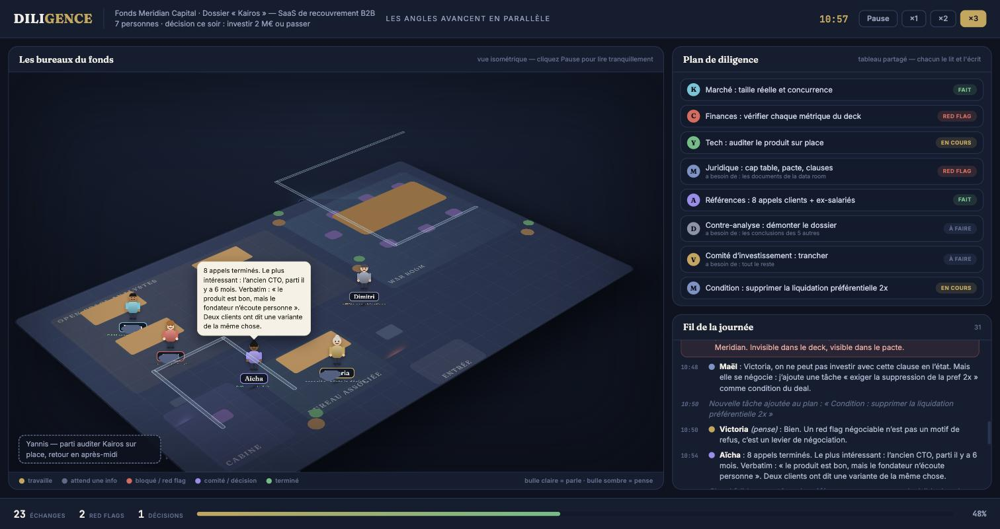

# Démos multi-agents

Deux simulations interactives qui montrent comment fonctionne un système multi-agents IA, non pas par une explication, mais en regardant une équipe travailler : découpage des tâches, dépendances, blocages, erreurs détectées par un agent critique, tâches créées en cours de route, décision collective par vote.

**[Ouvrir les démos](https://nicolasraoulduval-ui.github.io/demo-multi-agents/)**

Chaque démo est un fichier HTML autonome, sans dépendance ni build. La simulation se déroule seule (pause, vitesse ×2 ou ×3) et se termine par un récapitulatif qui relie chaque scène à un concept d'architecture multi-agents réel.

## Les deux niveaux

| Fichier | Niveau | Sujet |
|---|---|---|
| `soiree-pizza.html` | Grand public | Six personnes organisent une soirée pizza pour vingt invités. Appartement vu de dessus, personnages animés, aucun jargon. |
| `comite-vc.html` | Cas métier | Un fonds VC a une journée pour décider d'investir 2 M€ dans une startup. Bureau en vue isométrique, due diligence complète, red flags (métriques maquillées, liquidation préférentielle cachée), vote du comité. |

`index.html` sert de page d'accueil et relie les deux.

## Concepts illustrés

- **Orchestrateur** : un agent découpe la mission, assigne et arbitre sans rien produire lui-même.
- **Mémoire partagée** : un tableau de tâches et des documents communs plutôt que tout faire passer par messages.
- **Graphe de dépendances** : des agents bloqués en attendant le travail d'autres agents. Le parallélisme n'est jamais total.
- **Agent critique** : un rôle dédié à contredire les autres, qui attrape des erreurs invisibles pour leurs auteurs.
- **Décomposition dynamique** : des tâches créées en cours de route quand un imprévu apparaît.
- **Décision collective** : débat cadré, vote, objection minoritaire consignée.

## Limite assumée

Les scénarios sont écrits à l'avance pour être pédagogiques. Un vrai système multi-agents produit ces comportements de façon émergente, avec plus de bruit, des erreurs non rattrapées et un coût en tokens. L'orchestration montrée ici est justement ce qui est difficile à obtenir en production.

## Lancer en local

Ouvrir `index.html` dans un navigateur.
